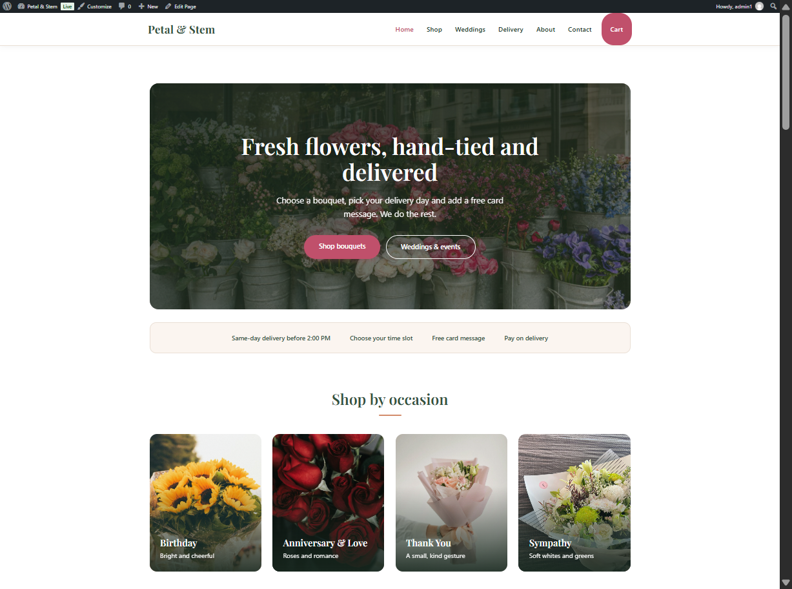
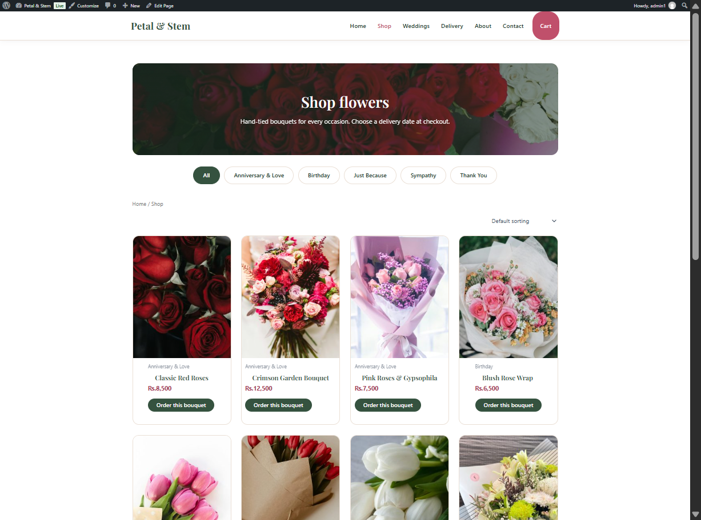
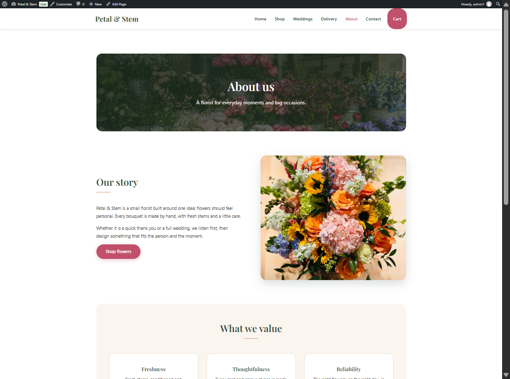
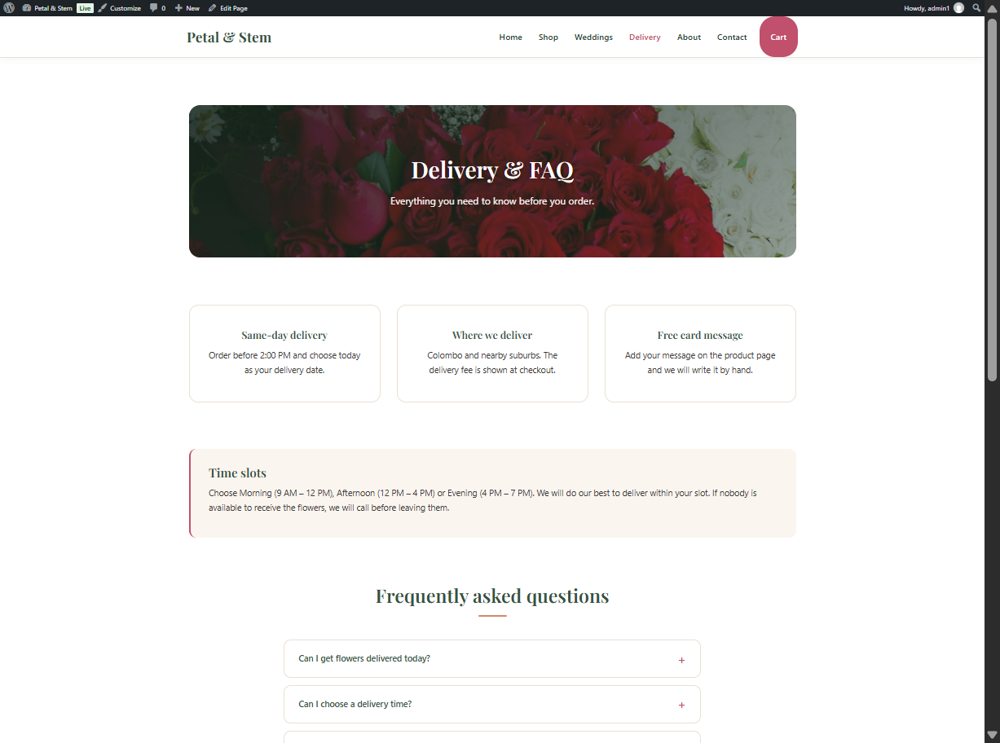
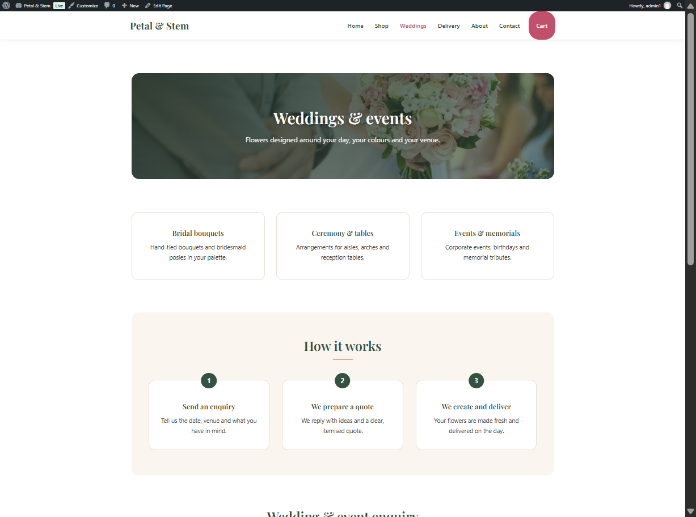
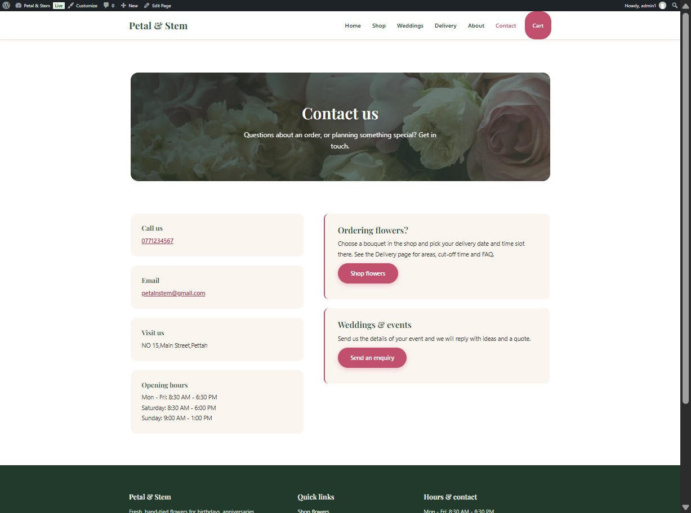

# Petal & Stem – Florist Website

A responsive florist and online flower shop website built with **WordPress**, **WooCommerce**, and a custom WordPress plugin. The project provides a catalogue of flower arrangements, online ordering features, delivery scheduling, and wedding and event enquiries.

This project was developed as a web development portfolio project and is configured for local development using WAMP.

## Website Preview

The following screenshots show the main pages of the website.

### Home Page


### Shop Page


### About Us


### Delivery & FAQ


### Weddings & Events


### Contact Us


## Key Features

### Online Flower Shop
- Product catalogue with sample bouquets organised by occasion.
- Product browsing and category filtering.
- WooCommerce shopping cart and checkout.
- Sri Lankan Rupee (LKR) price display using `Rs.`.
- Cash-on-delivery and flat-rate delivery configuration.

### Delivery Management
- Delivery date selection on product pages.
- Same-day delivery cut-off validation.
- Morning, afternoon, and evening delivery time slots.
- Optional gift card message for each order.
- Delivery information saved with the order and displayed in the cart, checkout, order emails, and administration area.
- Admin delivery planner that groups open orders by delivery date.

### Weddings & Events
- Enquiry form for wedding and event requests.
- Fields for event type, date, budget, and message.
- Form validation and spam-protection measures.
- Enquiry management area in WordPress administration.
- Enquiry status tracking and email notifications.

### Website Administration & Design
- Custom **Shop Details** settings page for contact information, delivery areas, opening hours, social links, and map details.
- Responsive page layouts and custom styling.
- WhatsApp contact button.
- FAQ and Privacy Policy content.
- Search-engine metadata, Open Graph tags, and Florist structured data.
- Custom footer and navigation menu.

## Technologies Used

| Area | Technologies |
|---|---|
| CMS | WordPress |
| E-commerce | WooCommerce |
| Backend | PHP |
| Frontend | HTML, CSS, JavaScript |
| Styling | Custom CSS, Astra theme |
| Database | MySQL |
| Local development | WAMP Server |
| Version control | Git and GitHub |

## Custom WordPress Plugin

The project includes a custom plugin:

`plugin/petal-stem-setup/`

The plugin adds the website setup and custom functionality, including:

- Website page and navigation setup.
- Sample bouquet catalogue setup.
- Delivery date, time-slot, and gift-message fields.
- Delivery validation and order details.
- Admin delivery planner.
- Weddings and events enquiry form and admin inbox.
- Shop Details settings.
- Custom website styling and supporting features.

WooCommerce and the Astra theme are external WordPress dependencies and are not included in this repository.

## Project Structure

```text
petal-and-stem-github-repo/
│
├── docs/
│   └── screenshots/
│       ├── localhost_flowers_.png
│       ├── localhost_flowers_shop_.png
│       ├── localhost_flowers_about_.png
│       ├── localhost_flowers_delivery_.png
│       ├── localhost_flowers_weddings-events_.png
│       └── localhost_flowers_contact_.png
│
├── plugin/
│   └── petal-stem-setup/
│       ├── css/
│       │   └── petal-stem.css
│       ├── images/
│       └── petal-stem-setup.php
│
├── .gitignore
└── README.md
```

## Local Installation

### Requirements
- WAMP Server or another local PHP and MySQL environment.
- A WordPress installation.
- WooCommerce plugin.
- Astra theme.

### Setup Steps
1. Install and run WAMP Server.
2. Create a MySQL database for the WordPress installation.
3. Install WordPress in your local web server directory.
4. From the WordPress dashboard, install and activate the **Astra** theme.
5. Install and activate the **WooCommerce** plugin.
6. Install the custom plugin from this repository:
   - Open **Plugins → Add New → Upload Plugin**.
   - Create a ZIP file of the `petal-stem-setup` folder, if required.
   - Upload the ZIP file and activate **Petal & Stem Setup**.
7. Open **Settings → Shop Details** and enter the appropriate shop information.
8. Configure WooCommerce settings, including currency, payment, and delivery options, as required.

> **Note:** This repository contains the custom project plugin, styling, images, documentation, and screenshots. It does not contain a complete WordPress installation or a database backup. The website must be set up in a separate WordPress environment.

## Security & Configuration

- WordPress configuration files and database dumps are excluded from version control.
- Local logs, uploads, and cache files are excluded through `.gitignore`.
- Configure database credentials and shop contact details in your own local environment.
- Do not commit passwords, API keys, private customer information, or production configuration files.

## Project Information

**Project:** Petal & Stem – Florist Website  
**Platform:** WordPress  
**E-commerce:** WooCommerce  
**Development Environment:** WAMP Server  
**Project Type:** Web Development Portfolio Project

## Photo Credits

Website flower photographs are sourced from [Unsplash](https://unsplash.com) and used under the Unsplash License. Photographer credits are listed in the project documentation/source README where applicable.
